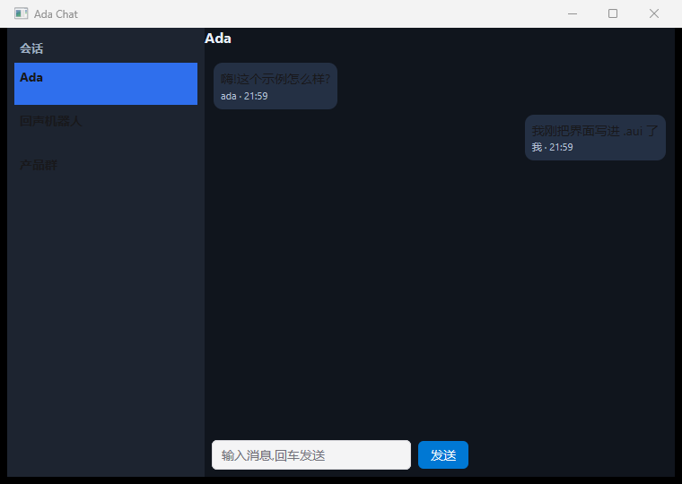
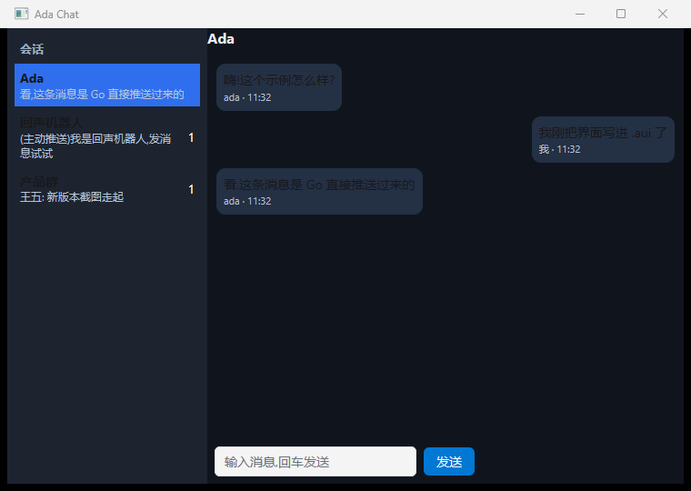
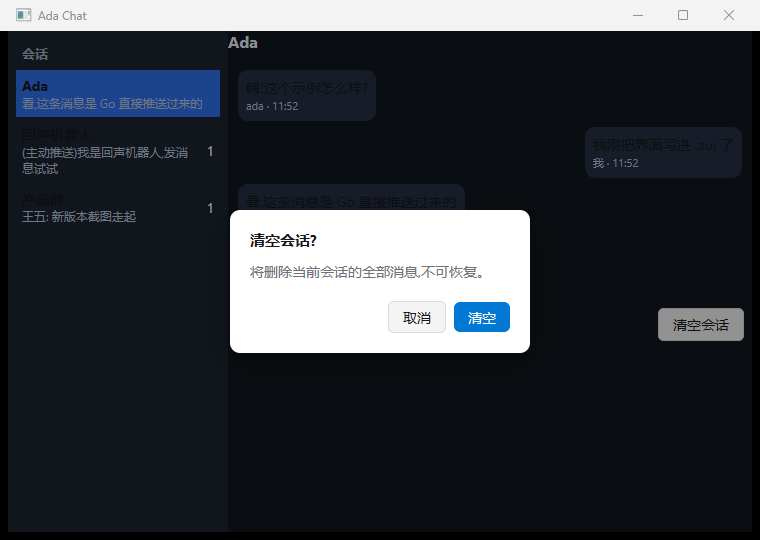
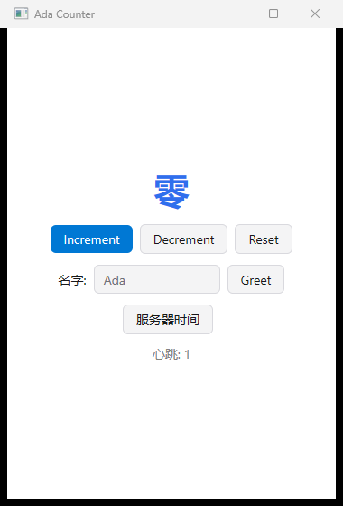
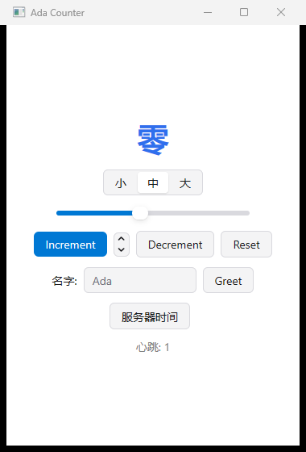
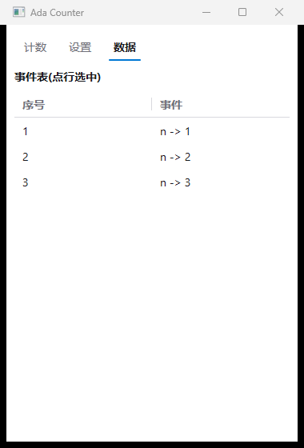
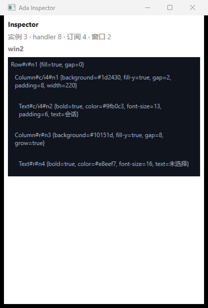
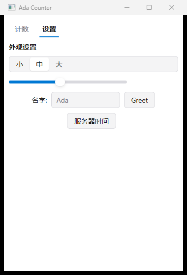
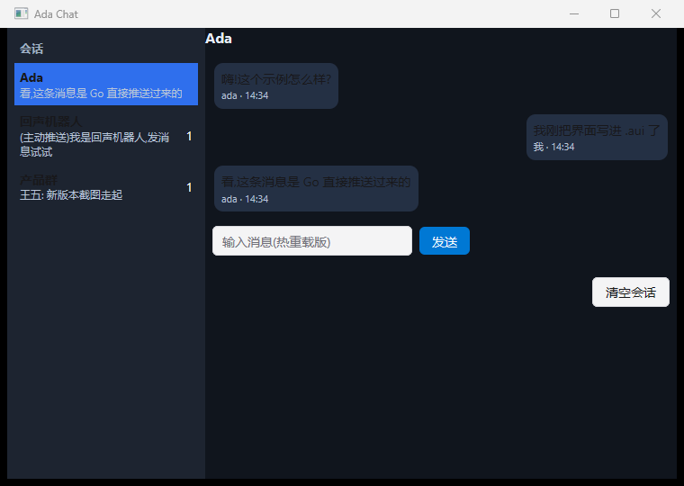

# ada_t — 前端式开发 golang native GUI 的运行时编译层

> 一句话:用 `.aui` 单文件组件(模板 + TypeScript setup + scoped 样式)写界面,像写 Vue 一样;
> 本层在 Go 进程内完成 **运行时编译**(模板→RenderPlan、esbuild 降级 TS→ESM、moejs 跑细粒度响应式
> 与 Plan 解释器),再由后端重放为 **mygo 原生控件**(GPU 绘制,无 webview、无 Node)。

设计依据:

- [mygo 文档](https://mygo.run/zh/docs) / [mygo UI 文档](https://mygo.run/zh/docs/ui) —— mygo 的原生 UI 是
  immediate-mode 的纯 Go `ui` 包,窗口在 GPU 上直接绘制(macOS Metal / Windows Direct3D 11 / Linux OpenGL),
  没有浏览器也没有 JavaScript;`View(func(c *ui.Context))` 每帧根据状态重建界面。
- 同作者仓库里的 `ada_go_v2/docs/ui-framework.md` —— Ada UI 设计方案(无 Node 的
  插件化 SPA 前端框架):本仓库把它的一整套机制(SFC → RenderPlan JSON AST → 解释器渲染 → 受限表达式 →
  esbuild 只做 TS 降级 → 禁 eval)从「浏览器渲染」移植到「moejs + 原生控件」。

## 0. 总体架构

```
┌────────────────────────────────────────────────────────────────────┐
│ .aui 组件源码(前端式开发)                                        │
│   <template> 模板 + Ada 指令 · <script lang="ts"> setup ·          │
│   <style scoped> class 令牌 · <i18n> 文案 · <meta> 名字            │
└──────────────┬─────────────────────────────────────────────────────┘
               │ ① 运行时编译层(Go,进程内,同输入同字节可 golden)
┌──────────────▼─────────────────────────────────────────────────────┐
│  sfc/        切块 meta/template/script/style/i18n                  │
│  templatec/  模板 tokenizer+parser → RenderPlan(JSON AST)         │
│  expr/       受限表达式 → JSON AST(§4.2;禁赋值/new/this/全局)      │
│  scriptc/    esbuild:TS → ES2022 ESM(逐文件 Transform,不打包)     │
│  stylec/     <style scoped> → class → 控件属性令牌                 │
│  compile/    整合:相对导入解析、产物 manifest(sha256)与 Verify    │
└──────────────┬─────────────────────────────────────────────────────┘
               │ ② JS 运行时(moejs + eventloop,专属 goroutine)
┌──────────────▼─────────────────────────────────────────────────────┐
│  surface.js(ada:surface,内嵌 ESM)                                │
│    reactive/ref/computed/watch/effect(Proxy 深代理 + 微任务批处理) │
│    Plan 解释器:求值动态槽 → 产出 widget 树(JSON)                  │
│    事件分发:handler 注册表;fire 求值动作 AST(裸名/调用/赋值)     │
│    组件实例:setup 只跑一次;props 响应式;子实例复用与清扫          │
└──────────────┬─────────────────────────────────────────────────────┘
               │ ③ 渲染桥(internal/rt):渲染 pass 调度(notify 合帧)、
               │    事件回注(Fire)、输入双向绑定
┌──────────────▼─────────────────────────────────────────────────────┐
│  ④ Backend(可插拔)                                                │
│    mygoui/  widget 树 → mygo ui 原生控件重放(GPU 绘制)             │
│    headless/ 树快照 + 帧日志 + 事件注入(测试 / CI / adat render)   │
└────────────────────────────────────────────────────────────────────┘
```

一次点击的链路(对齐 ui-framework.md §3.2):

```
用户点击原生按钮
  → mygo 主线程:view 重放时 Button.Clicked() == true
  → Dispatch → rt.Fire(hid)(RunOnLoop 投递到 moejs 专属 goroutine)
  → surface:求值动作 AST(如 inc)→ state.count++(Proxy set 触发)
  → 微任务 flush:watch/computed 联动 → __adatHost.notify() → Go 调度渲染 pass
  → renderWindow(winID):解释 Plan,求值所有动态槽 → widget 树 JSON
  → Go 反序列化 → backend.Apply → mygo Window.Invalidate → 下一帧重放新树
```

## 1. 关键决策(与 ui-framework.md 的映射)

| # | 决策 | 对应 ui-framework.md | native 场景的差异 |
|---|------|---------------------|------------------|
| D1 | 模板/组件在 Go 里编译,运行时只解释 Plan | D1/D2 | 浏览器换成 moejs;「浏览器不做编译」变成「moejs 不做编译」 |
| D2 | RenderPlan 是可序列化 JSON AST | D2 | Plan 同时喂给 surface.js(渲染)与 manifest(签名/审计) |
| D3 | 细粒度响应式 + 解释器,不做虚拟 DOM | D3/D10 | Proxy 深代理在 moejs 里原生可用(test262 全过) |
| D4 | esbuild 只做 TS→ESM 降级,逐文件 Transform | §5.3 | 相同;虚拟模块名 `<File>.aui.js`,loader 按 lang 显式指定 |
| D5 | 表达式是静态 AST,运行时解释求值,不 eval/拼字符串 | §4.2/§9.1 | 相同;`DisableDynamicCode: true` 关闭 moejs 的 eval/Function |
| D6 | 裸文本自动包 `<Text>`;标签/属性白名单 = native 控件面 | §4.2 白名单 | 浏览器 HTML 子集换成 Column/Row/Text/Button/TextInput… |
| D7 | 样式编译为「class → 控件属性令牌」 | §4.4 令牌 | 无 CSS 引擎:`.hero { font-size: 44 }` 编译期变成控件属性 |
| D8 | 渲染输出纯数据树,由 Backend 重放为原生控件 | §6.3 Op 序列 | 立即模式(mygo 每帧重建)天然贴合,无需 diff |
| D9 | headless 后端 + op/帧日志做 CI 门禁 | §14 OpAdapter | 无 GUI 也能验证编译层闭环(`adat render`) |

**有意偏离(说明理由)**:

1. **渲染是「状态变更 → 全树重求值」,不是绑定级 effect**:mygo 是 immediate mode,每帧重建本来就是它的
   工作方式;全树求值在组件规模(数十节点)下远低于帧预算。JS 侧响应式保留完整(依赖追踪、computed 缓存、
   watch),它驱动「何时渲染」;「渲染什么」由 Plan 全量求值。Plan 级 diff 留作 headless 断言与未来优化。
2. **事件动作允许裸名路径**(如 `a-on:click="todo.remove"`):求值期校验「是函数」,编译期不做跨文件类型推断
   (与 §5.2 一致)。
3. **`onMount` 在 setup 完成后立即执行**(无首帧前/后区分):native 组件没有「挂载到 DOM」的时点。
4. **a-model 目标只允许点路径**(拒绝下标):输入绑定键要跨帧稳定(后端持指针)。
5. **热重载按「数据 / 脚本」分流**:模板、样式、i18n 变更只换数据,实例与状态完整保留;脚本变更
   (含其依赖模块变更)重跑受影响组件的 setup。需要整体重置时重建 App(旧实例 Close),不做原地换世界。

## 2. 快速上手

```sh
go build ./...            # 全部构建
go test ./...             # 全部测试(无需 GUI/Node)
go run ./cmd/adat lint examples/counter     # 编译诊断
go run ./cmd/adat render examples/counter   # headless 渲染首帧,打印 widget 树
go run ./cmd/adat build examples/counter -o dist/ui   # 产物 + manifest(sha256)+ verify
go run ./cmd/adat run examples/counter      # 打开原生窗口(需要显示器)
go run ./cmd/adat inspect examples/chat -entry Chat  # headless 装载,打印 stats + widget 树(-live 2s 持续刷新)
go run ./cmd/adat watch examples/chat -entry Chat    # 组件级热重载(模板变状态保留;脚本变重跑 setup)

# 聊天示例(多组件 + Go 服务桥 + 异步事件推送 + Scroll + 回车发送)
go run ./examples/chat

# 演示驱动:模拟联系人陆续发来消息(看实时气泡与未读徽标)
ADAT_CHAT_DEMO=1 go run ./examples/chat

# 运行期检查器:每 2 秒向终端转储 stats 与各窗口 widget 树
ADAT_INSPECT=1 go run ./examples/chat
```

> Windows PowerShell 用 `$env:ADAT_INSPECT=1; go run ./examples/chat`,CMD 用 `set ADAT_INSPECT=1 && ...`。

> 目录内有多个 `.aui` 时,CLI 必须用 `-entry`(或 `compile.Options.Entry`)指定入口;
> 未指定会直接报错,而不是猜测第一个文件。

## 组件级热重载(HMR)

```sh
adat watch examples/chat -entry Chat      # CLI 通用监听(不含宿主服务)
ADAT_CHAT_WATCH=1 ADAT_CHAT_DEMO=1 go run ./examples/chat   # 示例自带 watch(服务在线)
```

变更语义(对齐 Vue HMR 的常用子集):

| 变更 | 行为 |
|---|---|
| 模板 / 样式 / i18n | 只换数据,实例与状态**完整保留**,下一帧生效 |
| 脚本 | 重跑受影响组件的 setup(props 保留,组件内部状态重置),窗口不关 |
| 被导入的模块(.ts/.js) | 变更沿 import 反向闭包传播:受影响模块与其导入者重新定义,相关组件重跑 setup |
| 新增组件 | 热装载并可立即使用 |
| 编译失败 | 旧世界继续服务,错误打在终端 |

实现:初始装配走 ESM 模块图;热重载的增量代码经 esbuild 降级为 CJS、
`RunScript` 以经典脚本进入已加载的运行时(surface 提供 require 垫片:
`ada:surface` API + 相对导入按编译期解析映射惰性装载)。整段 HMR 脚本
先编译后执行——编译失败旧世界不受影响。

宿主程序接入:`app.HotReload(pkg)`(任意 goroutine)+ `adat.WatchDir(dir, entry, interval, onPkg)`
监听辅助。依赖传播覆盖包内的静态 import 闭包(含组件脚本);循环导入的 CJS 工厂按惰性语义执行,
极端循环场景未承诺;`scanImports` 是词法扫描,注释/字符串里形如 import 的文本可能被误判为依赖
(只会导致多定义一次,不会错更新)。

## 插件(宿主把组件包嵌进自己的窗口)

`.aui` 不仅能驱动自己的窗口,也能作为**插件**嵌进宿主(如 ada_chat)已有的 mygo 界面:
宿主决定位置/尺寸/主题,插件只声明「槽位 + 组件」,能调哪些服务由能力白名单控制。
完整设计见 [docs/plugins.md](docs/plugins.md)。

```go
hostPkg, _ := adat.CompileDir("examples/plugin-host/host", "")
b := embed.New(embed.Options{Theme: tokens})
app, _ := adat.NewApp(hostPkg, adat.AppOptions{Backend: b, SlotMode: true, Theme: tokens})
app.RegisterSlot(plugin.SlotSidebarItem)
app.ExposeHost("host", "greet", func() string { return "hi" })
_, _ = app.LoadPluginDir("examples/plugins/hello")
for _, v := range app.SlotViews(plugin.SlotSidebarItem) { b.Draw(c, v.ID) } // 宿主自己的 view
app.EmitTo("hello", "ping", nil)                                          // 宿主 → 插件
app.UnloadPlugin("hello")                                                 // 视图/组件/订阅一起回收
```

- **清单** `plugin.json`:`id/version/entry/deps/capabilities/slots`,可选 `sha256`/`signature`。
- **槽位**:`sidebar.item` / `chat.header_action` / `composer.action` / `message.renderer` /
  `settings.tab` / `command`(宿主可自定义)。
- **能力**:插件 `ctx.api.call('host', 'bots.list')` 必须在 `capabilities` 声明 `host.bots.list`,
  否则抛异常;`HostCapabilities()` 可生成白名单文档。
- **事件**:插件 `ctx.on` 只订阅 `plugin.<id>.*`;`ctx.emitHost` → 宿主 `OnPluginEvent`。
- **主题**:`ctx.theme()` 读宿主下发的 token,模板里 `a-bind:color="theme.fg"`。
- **信任**:`PluginTrust{RequireDigest, PublicKeys}`;内部插件用 `adat plugin build -write` 写摘要,
  第三方用 ed25519 签名。
- **边界**:同进程,安全靠编译期(受限表达式/无 eval)+ 能力白名单,**不是进程隔离**。

示例:`go run ./examples/plugin-host`(宿主原生窗口 + Hello 插件),插件源码在
`examples/plugins/hello/`。

## 截图

聊天(多组件 + Go 推送 + 对话框/Toast;图见 `docs/screenshots/`):







计数器(i18n + 样式令牌 + 服务桥 + 心跳):



计数器接入 Segmented/Slider/Stepper(档位联动滑杆调字号):



计数器「数据」页签:虚拟化 Table(Go 推送模拟点击产生行):



调试面板(Go 推送 stats + 组件树):



计数器 Tabs 页签(计数 / 设置;Go 事件驱动切换):



聊天 HMR:编辑 `.aui` 占位文案后热重载进运行中的窗口(消息与推送全部保留):



## 控件词表(native 标签)

> 完整的组件作者参考(指令/表达式/setup 契约/常见模式)见 [docs/cheatsheet.md](docs/cheatsheet.md)。

| 标签 | 关键属性 | 事件 |
|---|---|---|
| Column / Row | fill / fill-x / fill-y / center / gap / gap-x / gap-y / padding / width / height / grow / align / justify / background / radius | click(仅绑定了 click 的容器参与命中,不吞子级点击) |
| Scroll | fill / grow(填满剩余空间) | — |
| Text | text(内容)/ font-size / bold / color / align(行内对齐)/ width / height / grow / padding | — |
| Button / PrimaryButton | label(子文本)/ width / height / grow | click |
| TextInput | a-model 文本 / placeholder / grow | input、submit(回车) |
| NumberInput | a-model 数值 / min / max / step / grow | input |
| Slider | a-model 数值 / min / max / grow | input(拖动) |
| Stepper | a-model 数值 / min / max / step / grow | input |
| Segmented | a-model = 选中项文本 / options="小,中,大" / fill-x / grow | change |
| Tabs | a-model = 选中项文本 / options="页1,页2" / fill-x / grow | change(配合 a-if 切换内容面板) |
| Split | a-model = 第一面板宽度(DIP,可拖拽双向)/ vertical 上下分栏 | input |
| Switch / Checkbox | a-model 布尔 / label | change |
| AlertDialog | a-model 开关(双向)/ title / message / buttons="取消,确定" | action({index,label})、dismiss |
| Progress | value / width / grow | — |
| Table | a-model = 选中行下标 / a-bind:rows = 行对象数组 / columns="标题1,标题2" / fields="字段1,字段2" / follow-end 贴底 | change({value}) |
| Rating | a-model = 星数(int)/ max | change({value}) |
| Spacer / Divider | — | — |

约定:大写自定义组件名不能与内置控件重名(重名会被当成内置控件);表单控件的值
经后端双向同步(用户编辑实时回传,JS 更新实时下发)。所有布局属性
(fill/grow/padding…)对输入与选择类控件同样生效,`Text` 的 `align` 映射为行内文本对齐。
颜色值支持 `#rgb`/`#rgba`/`#rrggbb`/`#rrggbbaa` 与有限命名色,非法 `#hex` 在编译期报
`EUISTYLE`/`EUITEMPLATE`(动态 `a-bind` 由重放层兜底)。

## 调试面板(Inspector)

```sh
adat run examples/chat -entry Chat -inspector    # 多开一个原生调试窗口
ADAT_INSPECT=1 go run ./examples/chat             # 或向终端周期转储
```

面板实时展示注册表统计(实例/handler/事件订阅/窗口)与各窗口的组件树
(按深度缩进,含模型绑定与事件)。数据链路:`widget.Flatten` + `rt.FlatRows`
→ `__inspector` 事件推送 → 内嵌 `Inspector.aui` 组件渲染。组件包经
`rt.LoadAdditional` 装载(附加包语义:不影响主包热重载基准)。

## 对话框与提示

```aui
<!-- 确认对话框:a-model 双向开关,Escape/按钮关闭自动写回 -->
<AlertDialog a-model="state.confirming"
             a-bind:title="$t('confirm-title')" a-bind:message="$t('confirm-msg')"
             buttons="取消,删除" a-on:action="onConfirm" a-on:dismiss="onDismiss" />
```

```js
// 组件里
ctx.toast('已保存')   // 窗口底部弹一条几秒自动消失的提示
```

- `AlertDialog`:`open` 经 a-model 双向绑定(`props.open` 同步进原生弹层,Escape/按钮关闭写回状态);
  `buttons` 属性逗号分隔;`a-on:action` 收 `{index, label}`(点击的按钮),`a-on:dismiss` 收 Escape/取消
- `ctx.toast`:入队到所属窗口,重放帧经 `context.Toast` 显示;需要后端实现 `backend.ToastSource`
  (App 已自动接线到 rt 的队列)

组件(`examples/counter/Counter.aui`,完整版见该文件):

```aui
<template>
  <Column fill center gap="12">
    <Text font-size="40" bold>{{ display }}</Text>
    <PrimaryButton a-on:click="inc">Increment</PrimaryButton>
    <TextInput a-model="state.who" placeholder="Ada" />
    <Text a-if="state.who !== ''">你好, {{ state.who }}!</Text>
    <Row a-for="log, i in state.log" a-key="log" gap="4">
      <Text color="gray">{{ i }}: {{ log }}</Text>
    </Row>
  </Column>
</template>

<script lang="ts">
import { reactive, computed, watch } from 'ada:surface'

export default {
  name: 'Counter',
  setup(props, ctx) {
    const state = reactive({ n: 0, who: '' })
    const display = computed(() => state.n === 0 ? ctx.t('zero') : String(state.n))
    watch(() => state.n, (nv) => ctx.log('n ->', nv))
    function inc() { state.n++ }
    return { state, display, inc }
  },
}
</script>

<style scoped>
.hero { font-size: 44; bold: true; color: #2f6fed; }
</style>

<i18n>
{ "zh-CN": { "zero": "零", "hello": "你好" } }
</i18n>
```

Go 侧只需装载与开窗:

```go
pkg, err := compile.CompileDir("examples/counter", compile.Options{})
app, _ := adat.NewApp(pkg, adat.AppOptions{Backend: mygoui.New(), Locale: "zh-CN"})
app.Window(adat.WindowOptions{Title: "Counter", Width: 360, Height: 480})
app.Run()
```

## 2.1 Go 服务桥(ctx.api.call / Emit)

UI 写在 `.aui` 里,数据面写在 Go 里,两者经桥连接(ui-framework.md §9.5 能力桥的 native 版):

```go
// Go 侧:暴露服务(任意时刻可调)
app.Expose("server", "now", func() string { return time.Now().Format("15:04:05") })
app.Expose("server", "greet", func(name string) (string, error) {
    if name == "" { return "", errors.New("名字是空的") }
    return "你好," + name, nil
})
// Go → 组件广播事件(任意 goroutine)
app.Emit("tick", map[string]any{"n": 1})
```

```js
// 组件 setup 里
ctx.api.call('server', 'now')            // 同步调用;Go error → JS 异常
await ctx.api.callAsync('chat', 'send', id, text)  // 异步:Promise,不阻塞渲染
ctx.on('tick', (p) => { state.ticks = p.n })  // 订阅广播;实例卸载自动退订
```

契约(`internal/rt/service.go`):

- 参数按函数签名逐个从 JSON 反序列化,返回值序列化回 JS——`float64`/`string`/`bool`/结构体/切片/映射皆可
- 签名支持 `func() T`、`func(...) (T, error)`、`func(...) error`;首参是 `context.Context` 时自动注入;变参拒绝
- **同步 `call`** 在 **loop goroutine** 上执行:慢调用会阻塞渲染,只适合内存级快速操作
- **异步 `callAsync`**:同一个 Go 函数跑在独立 goroutine,经 `eventloop.NewPromise` 的 settle 回到
  loop 完成 Promise;Go error → Promise 拒绝(`await`/`catch` 接收)。**实现必须自行保证并发安全**(自己加锁)
- 响应式与渲染解耦:任何路径的状态变更(包括异步续体)都会经 trigger → flush → notify 触发重渲染
- 调用不校验权限:同进程同信任域(对齐 §9.2「同域 = 完全可信」;真边界是进程边界)


## 3. `.aui` 组件契约

| 块 | 必需 | 说明 |
|---|------|------|
| `<meta>` | 否 | `{"name": "Counter"}`;缺省用文件名 |
| `<template>` | **是** | 单根元素;Ada 指令;大写标签 = 包内组件 |
| `<script lang="ts">` | 否 | default export `{ setup(props, ctx) → bindings }`;可 `components: { Sub }` |
| `<style scoped>` | 否 | 只允许 `.class { 属性: 值 }`;属性白名单;天然按组件隔离 |
| `<i18n>` | 否 | `locale → key → 文案`;`$t(key, ...args)` 用 `{0}` 占位 |

**指令**:(`§4.2` 的 native 子集)

| 写法 | 含义 |
|---|------|
| `{{ expr }}` | 插值(转义;AST 解释求值,不 eval) |
| `a-if` / `a-else-if` / `a-else` | 条件链(必须相邻兄弟;归一为单 if 节点) |
| `a-for="item, i in list"` + `a-key` | 列表;缺 a-key 告警 |
| `a-on:click="inc"` / `select(item)` | 事件;裸名动作收 `$event` 作为第一参 |
| `a-model="state.query"` | 双向绑定(TextInput 文本 / NumberInput 数值 / Switch/Checkbox 布尔) |
| `a-bind:gap="state.gap"` | 动态属性 |
| `a-class:active="state.on"` | 动态 class(配合样式令牌) |
| `a-prop:label="state.label"` | 子组件动态 props;静态属性直传 |

**表达式**(ui/expr):字面量、路径/下标、一元 `!`/`-`、算术、比较(`==` 即严格相等)、`&&`/`||`/`??`、
三元、数组、括号、作用域内函数调用与 `$t`。拒绝赋值、`new`、`this`、`await`、链式调用。
根表达式是 ref/computed 时自动解包一层。

**控件词表**(native 标签,21 个)与属性白名单见 `internal/templatec/templatec.go` 的 `nativeTags`:
布局 Column/Row/Scroll/Split;文本 Text;按钮 Button/PrimaryButton;输入 TextInput/NumberInput/Slider/Stepper;
选择 Segmented/Tabs/Table/Rating/Switch/Checkbox;反馈 AlertDialog/Progress;占位 Spacer/Divider。
可双向绑定的控件另受 `modelTags` 约束。新增控件 = 白名单 + `modelKind`(若可绑定)+ mygoui 重放分支 + 重放测试。

**诊断码**(附录 A 子集):`EUISTRUCT`(切块/结构)、`EUITEMPLATE`(指令/标签/属性)、`EUIEXPR`(表达式)、
`EUISTYLE`(样式)、`EUISECURITY`(on*/a-html)、`EUIIMPORT`(裸包名/越界导入,Link 时)、`EUIARTIFACT`(产物摘要)。

## 4. 线程模型(moejs 硬约束)

moejs Runtime 只能在专属 goroutine 上使用。本层:

- `eventloop.Loop`(专属 goroutine,`Start()` 一直跑到 `Stop`):所有 JS 交互(装配、渲染 pass、事件求值、
  定时器)都经 `RunOnLoop` 投递。同步服务(`ctx.api.call`)与 `OnTree` 回调在 loop 上执行,慢调用会阻塞
  渲染——长任务用 `callAsync`;在 loop 回调里再调 `Stats/MountWindow/HotReload` 等往返 API 会自锁。
- 关闭协议:`Close` 先关闭内部 `closedCh` 再 `loop.Stop()`,等待 loop 的调用方立即返回错误,
  不会因 Stop 丢弃未执行任务而永久阻塞。
- mygo 主线程:每帧 view 重放(只读快照);`Clicked()`/输入差异经 Dispatch → `rt.Fire` 投递回 loop。
- `notify` 合帧:响应式 flush → 原生函数 → Go `notifyPending` CAS → 一个 loop 轮次最多一个渲染 pass。
- 渲染输出是 JSON 字符串跨边界;handler 用 id 注册表回指,跨边界不传函数。

## 5. 产物与签名(§5.6 简化版)

`adat build` 产出:

```
dist/ui/
  Counter.plan.json      # RenderPlan(数据,可审计)
  Counter.module.js      # 组件脚本(esbuild 降级,ESM)
  ui.manifest.json       # planVersion/entry/components/files[{name,sha256,bytes}]/digest
```

`digest = sha256(规范化 manifest,不含 digest 字段)`;`compile.Verify(dir)` 逐文件校验 sha256 与字节数,
篡改即 `EUIARTIFACT`。签名/安装管线(§8)不在本层范围——它是宿主(L2 install)的事。

## 6. 测试矩阵(全部 Go,无 Node)

| 层 | 文件 | 覆盖 |
|---|---|---|
| 表达式 | `internal/expr/expr_test.go` | 语法面、拒绝面(赋值/new/this/链式调用)、动作、AST JSON golden |
| 切块 | `internal/sfc/sfc_test.go` | 五块、缺失/重复/未知块、未闭合 |
| 模板 | `internal/templatec/templatec_test.go` | if 链归一、for 包裹、裸文本包 Text、词间空白、a-model(控件白名单/事件冲突)、安全拒绝、根约束、告警、id 稳定 |
| 样式 | `internal/stylec/stylec_test.go` | 令牌、@规则/全局选择器/url()/白名单外属性/重复规则拒绝 |
| 降级 | `internal/scriptc/scriptc_test.go` | TS 擦除 + enum 内联、语法错误、loader 选择 |
| 编译 | `internal/compile/compile_test.go`、`regression_test.go` | 相对导入解析、裸包名/越界拒绝、多组件入口、Build→Verify→篡改检测、构建确定性、manifest 摘要/路径安全、模板/脚本/样式诊断源文件坐标 |
| 运行时 | `internal/rt/rt_test.go`、`regression_test.go`、`roadmap_test.go` | 端到端:首帧、点击→computed、a-if、a-model、a-for 增长、watch、$t、嵌套组件 props/emit、EUIIMPORT;多窗口事件、handler 跨帧稳定、动态 props、附加包后 HMR、子组件 setup 错误卡片、服务 panic、watch stop;props 删除同步、零参调用、单次渲染、渲染错误保子实例、HMR 依赖传播、Close 不挂起 |
| 原生重放 | `backend/mygoui/replay_test.go`、`fixes_test.go` | mygo Tester 无窗口驱动:按钮点击、TextInput 双向同步、Checkbox/Segmented 事件与去重;Split 绑定、容器点击冒泡、非法颜色回退、grow 布局、Text 行内对齐、21 标签重放冒烟 |
| 后端 | `backend/headless/headless_test.go` | Apply/帧计数/日志、Fire 查树派发、Stop-before-Run 不阻塞、Run/Stop |
| 插件 | `plugin/plugin_test.go`、`internal/rt/plugin_test.go`、`plugin_host_test.go` | 清单校验/通配/ed25519 签名;装载首帧、能力允许/拒绝、事件前缀、模块前缀隔离、卸载回滚、重名拒绝;公共 API + embed 绘制 + 点击回传 + 主题 + 槽位注册 + 信任策略;示例插件不漂移 |
| 公共 API | `app_test.go`、`cmd/adat/main_test.go` | 窗口 id/WindowIDs、Run/Stop 幂等、Inspector 附加窗口、CLI 参数重排 |

运行时测试在 headless 后端上跑:`waitFor` 轮询树状态,等价于真实后端把原生事件翻译成 handler 调用。
原生重放测试用 mygo 的 `ui.Tester` 在内存里渲染并注入点击/输入,不需要显示器。

CI 见 [.github/workflows/ci.yml](.github/workflows/ci.yml):Linux(CGO=0)做 gofmt/vet/构建 + 核心测试,
Windows 做全量测试、race 与基准冒烟。`backend/mygoui` 的集成测试依赖 mygo 的 headless 渲染,
只在 Windows 门禁跑;race 覆盖 `. /internal/... /plugin /widget /backend/headless /backend/mygoui /backend/embed /cmd/adat`。

## 7. 目录

```
app.go                       公共 API(NewApp/Window/Run/Stop)
widget/widget.go             widget 树契约(JS→Go 边界)
internal/sfc/                .aui 切块
internal/expr/               受限表达式 → AST
internal/templatec/          模板 → RenderPlan
internal/scriptc/            esbuild TS→ESM
internal/stylec/             class → 控件属性令牌
internal/colorval/           颜色字面量校验(编译期诊断与重放兜底共用)
internal/compile/            编译整合 + 相对导入解析 + manifest/Verify + 目录指纹
internal/rt/                 moejs loop 宿主 + 渲染桥
internal/rt/surface.js       ada:surface(响应式 + Plan 解释器 + 事件分发)
backend/backend.go           Backend/Dispatcher 契约
backend/headless/            headless 后端(测试/CI)
backend/mygoui/              mygo 原生重放后端(GPU 绘制;Renderer 可嵌进宿主 Context)
backend/embed/               embed 后端:槽位树画进宿主自己的 ui.Context
plugin/                      插件清单(manifest/能力/签名)与槽位常量
plugin_host.go               公共插件 API(LoadPlugin/UnloadPlugin/SlotViews/信任策略)
cmd/adat/                    CLI(lint/build/render/inspect/run/watch/plugin/version)
examples/counter/            示例:Counter.aui + main.go(服务桥 + 心跳)
examples/chat/               示例:聊天(Sidebar/Bubble 子组件、Scroll、回车发送、机器人回声)
examples/plugin-host/        示例:宿主原生窗口 + 插件槽位(Draw)
examples/plugins/hello/      示例插件:plugin.json + 两个槽位组件
```

## 8. 已知边界与后续项

- **mygo 重放的目测验证**:`backend/mygoui` 的重放逻辑与 API 用法均按 mygo v0.10.0 的公开 API 编写并
  通过编译,但本环境无显示器,未做像素级目测;`adat run` 请在有桌面环境的机器上确认。
- 输入同步覆盖 TextInput/NumberInput/Slider/Stepper/Segmented/Tabs/Table/Rating/Split/Switch/Checkbox/AlertDialog;
  富文本、组合框、日期选择等未接入。
- `a-key` 目前只做「缺失告警」,不参与实例身份:列表条目实例按渲染路径(含下标)复用,
  重排或在头部插入条目会带走该位置的组件内部状态。需要稳定条目状态时,建议把状态提升到父组件。
- Plan 级 diff 优化、子组件跨包引用、远程加载/签名安装(§8)不在本层承诺内。
- 插件(见 [docs/plugins.md](docs/plugins.md)):同进程、同 loop;安全靠编译期受限表达式与能力白名单,
  **不是**运行时权限隔离。组件名全局唯一;插件不参与主包 HMR(改动后 UnloadPlugin + 重装);
  `deps` 只记录不解析;插件不能自己 Expose 服务。
- `ctx.emit` 在 setup 之后触发(渲染期的父绑定);`onUnmount` 由实例清扫保证。
- 组件标签名必须等于被引用组件编译后的名字(`<meta>` 的 name 或文件名),而不是 `import` 的别名;
  两者不一致时运行期会报「没有 Plan」。建议保持 `import Sub from './Sub'` 且 `<meta name="Sub">`。
- 数组批量变更(push/splice)粗粒度触发父键依赖;索引级细粒度留作优化。

### 性能实测(headless,`RenderOnce`:JS 全树求值 + stringify + 跨边界取字符串)

| 场景 | i5-13420H | i5-10500 复测 |
|---|---|---|
| 100 条目列表(每条 3 控件) | ~1.8ms | 2.5–3.1ms |
| 500 条目列表 | ~8.7ms | ~12.0–12.2ms |

注意:基准调 `RenderOnce`,**不含** Go 侧 `json.Unmarshal`、`widget.Flatten`、后端 `Apply`、flush/notify
与 no-op 去重,因此真实帧成本高于表中数值。一次状态变更只安排一个渲染 pass(见 `stats.renders`),
但仍会重算全部窗口的整棵树。

基准(`BenchmarkRenderList*`)作为回归守卫保留。曾实现 keyed a-for 条目记忆化
(item effect + 缓存子树),基准实测在常见条目规模下簿记开销超过跳过的重求值收益
(且测量方差 ±30% 掩盖差异),已回退为单一全量重求值路径——决策依据与数字见
`internal/rt/bench_test.go`。若未来出现大条目子树(每条 >10 控件)的场景,可再评估
细粒度方案。
